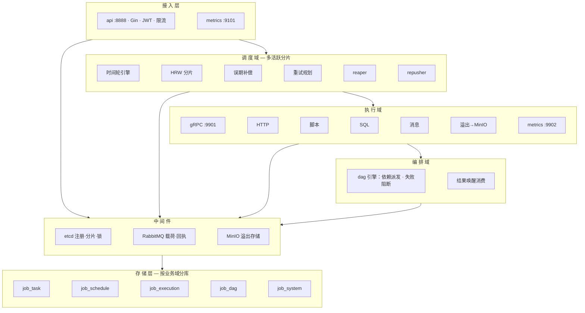

# job-scheduler

> 分布式任务调度平台 —— 基于 Go 的 Cron 任务调度、执行与编排系统


> ⚠️ **本项目仍在积极开发中，尚未发布稳定版。** 核心链路（Cron 调度 → 执行 → 重试 → DAG 编排 → 监控告警）已联调跑通，但 API 契约与表结构仍可能变更。见 [Roadmap](#roadmap) 与 [已知限制](#已知限制)。

---

## 项目简介

job-scheduler 是一个**多活跃节点**可部署的分布式任务调度平台，解决三件事：

- **定时触发**：秒级 Cron 解析器（5/6 字段表达式），时间轮驱动调度引擎（5s 周期全量校准，配置变更自动生效）；多活跃节点按 HRW 一致性哈希分片触发权，成员变动自动再均衡；误期执行按补偿策略（补发/跳过/合并）处理；
- **可靠执行**：调度结果经 gRPC 直推 executor（etcd 成员表服务发现），executor 原子抢票认领（天然防重复消费），失败按策略（固定间隔/指数退避，封顶 30min）自动重试，僵尸重试独立重推，卡死执行由 reaper 收割，手动触发与调度触发共用同一投递通道；
- **编排与观测**：DAG 工作流（YAML 导入、运行触发、依赖派发、失败阻断、结果回执唤醒、全生命周期管理），大结果三段式存储（内联/MinIO 溢出/预签名下载），Prometheus 指标 + Grafana 看板 + Alertmanager 邮件告警。

## 功能特性

### 已实现 ✅

| 模块 | 能力 |
|---|---|
| 用户 | 注册 / 登录（JWT 鉴权）、账号状态校验、撞名自动重试 |
| 任务 | CRUD、四种执行类型（HTTP / 脚本 / SQL / 消息）、领域级参数校验、按创建者的重名校验、**手动触发** |
| 调度 | Cron 表达式（5/6 字段，秒级）、暂停/恢复、misfire 补偿策略（补发/跳过/合并，运行期与补偿期一致生效）、5s 全量校准 |
| 执行 | gRPC 推送 + etcd 注册发现、原子抢票、失败重试（指数退避封顶 30min）、僵尸重试重推、超时收割、手动触发、结果回执 |
| 结果存储 | 三段式：≤32KB 内联 result 列；超限全量 gzip 直传 MinIO（信封含 sha256 + head/tail 预览），对象 30 天自动过期，孤儿 GC 兜底；MinIO 不可用自动降级摘要；**预签名下载端点** |
| DAG | YAML 导入 / 运行触发 / 依赖派发 / 失败阻断 / 编辑 / 启停 / 软删 / 节点数据流（上游输出 → 下游 stdin + `JOB_NODE_INPUTS` 环境变量，支持溢出信封回源） |
| 高可用 | 调度多活跃分片（etcd 成员租约 + HRW 再均衡）、触发互斥（分布式锁 + nextRun CAS）、Pending 执行独立重推器（Repusher） |
| 安全与治理 | JWT 密钥配置化、全局限流（默认 20rps/突发 100，429 响应）、LIKE 通配符转义、SQL 全参数化 |
| 可观测 | Prometheus 指标（api:9101 / scheduler:9100 / executor:9902）、Grafana 看板、Alertmanager 邮件告警 |

### 开发中 🚧

- DAG 前端视图（API 已就绪）
- 任务导入 / 模板

## 架构



**服务清单**

| 服务 | 职责 | 端口 |
|---|---|---|
| `api` | REST API（任务/调度/执行/DAG）、JWT 鉴权与限流、手动触发、结果下载 | 8888 / 9101 (metrics) |
| `scheduler` | 时间轮调度引擎（多活跃 HRW 分片）、重试规划、超时收割、误期补偿、投递补偿 | 9100 (metrics) |
| `executor` | 领取并执行任务（HTTP/脚本/SQL/消息），进程树超时击杀，结果溢出存储 | 9901 (gRPC) / 9902 (metrics) |
| `dag` | DAG 工作流引擎：运行推进、依赖派发、失败阻断、结果唤醒消费 | — |

## 技术栈

- **语言/框架**：Go 1.25、Gin、gRPC
- **存储**：MySQL（sqlx，按业务域分库）、MinIO（结果溢出存储，可选）
- **中间件**：etcd（成员注册/分片/分布式锁）、RabbitMQ（消息任务载荷 + DAG 结果唤醒）
- **可观测**：Prometheus / Grafana / Alertmanager、zap + lumberjack、pprof
- **工具链**：google/wire（依赖注入）、snowflake（ID）、viper（配置热加载）

## 快速开始

### 依赖

- Go ≥ 1.25、MySQL ≥ 8.0、etcd ≥ 3.5、RabbitMQ ≥ 3.8
- 可选：MinIO（结果溢出）、Prometheus / Grafana / Alertmanager（监控栈）

### 1. 准备配置

真实配置不进仓库。从模板复制后按本机环境填值：

```bash
cp configs/config.example.yaml configs/config.yaml
cp configs/alertmanager/alertmanager.example.yml configs/alertmanager/alertmanager.yml
```

然后编辑 `configs/config.yaml`：五个库的连接信息、RabbitMQ、etcd 地址、JWT 密钥（auth.jwt_secret，**必改**）。
`config.yaml` 与 `alertmanager.yml`（含 QQ 邮箱/SMTP 授权码等个人渠道）都在 `.gitignore` 里，勿用 `git add -f` 提交。

### 2. 建库建表

按域创建 5 个数据库（分库是本项目的硬约定，跨库只存 ID 不做外键），再执行 [sql/schema.sql](sql/schema.sql) 中对应表段（每段前的注释标明归属库）：

```sql
CREATE DATABASE job_task DEFAULT CHARACTER SET utf8mb4;
CREATE DATABASE job_schedule DEFAULT CHARACTER SET utf8mb4;
CREATE DATABASE job_execution DEFAULT CHARACTER SET utf8mb4;
CREATE DATABASE job_dag DEFAULT CHARACTER SET utf8mb4;
CREATE DATABASE job_system DEFAULT CHARACTER SET utf8mb4;
```

### 3. 构建与运行

约定以**仓库根目录**为工作目录启动（配置文件按相对路径解析）：

```bash
go build -o bin/api.exe ./app/cmd/api
go build -o bin/scheduler.exe ./app/cmd/scheduler
go build -o bin/executor.exe ./app/cmd/executor
go build -o bin/dag.exe ./app/cmd/dag

./bin/executor.exe
./bin/scheduler.exe
./bin/dag.exe
./bin/api.exe
```

启动顺序：etcd（`scripts/start-etcd.bat`）→ MySQL/RabbitMQ → executor → scheduler → dag → api。

### 4. 验证

```bash
# 注册（返回系统生成的 username）
curl -X POST http://127.0.0.1:8888/api/v1/register \
  -H "Content-Type: application/json" \
  -d '{"phone":"13800000000","password":"Demo123456"}'

# 用【响应里返回的 username】登录拿 token
curl -X POST http://127.0.0.1:8888/api/v1/login \
  -H "Content-Type: application/json" \
  -d '{"username":"<返回的username>","password":"Demo123456"}'
```

随后建任务、挂调度、导入 DAG，或直接调 API。全量 API 见下表。

## API 概览

统一前缀 `/api/v1`，统一响应 `{code, msg, data}`（成功 code=1000），鉴权 `Authorization: Bearer <token>`。

| 方法 | 路径 | 说明 |
|---|---|---|
| POST | /register、/login | 注册 / 登录 |
| POST/GET | /tasks/create、/tasks/list | 任务创建 / 分页查询（keyword/task_type/status 过滤，首页含精确 total） |
| GET/PUT/DELETE | /tasks/:id | 任务详情 / 更新 / 取消 |
| POST | /tasks/:id/trigger | **手动触发一次执行** |
| POST/GET | /schedules/create、/schedules/list | 调度创建 / 查询 |
| GET | /schedules/:id | 调度详情 |
| POST/DELETE | /schedules/:id/pause、/resume、/:id（DELETE） | 暂停 / 恢复 / 删除 |
| GET | /executions/list?task_id=&page=、/executions/:id | 执行历史（按任务分页）/ 详情 |
| GET | /executions/:id/result | **完整结果获取**：内联原文直返；溢出结果 302 到预签名下载 URL |
| POST/GET | /dags/import、/dags/:id | DAG 定义导入（YAML）/ 查询 |
| POST | /dags/:id/run | **发起一次 DAG 运行**（请求体为可选 JSON 上下文，≤64KB） |
| PUT | /dags/:id | 整体替换 DAG 定义（YAML） |
| POST/DELETE | /dags/:id/enable、/disable、/:id（DELETE） | DAG 启用 / 停用 / 软删 |

## 测试

```bash
go test ./app/...                  # 单元 + 功能测试
go test -race ./app/internal/...   # 竞态检测
```

真库集成测试（仓储层、坏运行隔离）在 MySQL 不可达时自动 SKIP。压测脚本（wrk Lua）见 `scripts/`（注意：全局限流默认 20rps，压测前调高或关闭），监控栈配置见 `configs/prometheus/`、`configs/alertmanager/`、`configs/grafana/`。

## Roadmap

- [x] Cron 调度引擎（时间轮）+ 多活跃分片 HA
- [x] gRPC 推送执行 + 失败重试 + 僵尸重推 + 超时收割
- [x] 结果三段式存储（内联 / MinIO 溢出 / 预签名下载）+ GC
- [x] Prometheus + Grafana + Alertmanager 可观测栈
- [x] 功能测试体系（领域层 + 真库集成）
- [x] SQL 建表脚本（sql/schema.sql）
- [x] DAG 运行触发 / 编辑 / 启停 / 删除 API
- [x] 手动触发执行 + 结果下载端点
- [x] JWT 密钥外置到配置
- [x] 限流中间件默认启用（429）
- [x] 多活跃节点调度分片与负载再均衡
- [ ] DAG 前端视图
- [ ] 任务导入 / 模板
- [ ] v0.1 稳定版发布

## 已知限制

- 前端视图正在开发（API 已全部就绪，暂用 curl / HTTP 客户端操作）；
- 配置为启动时读取：JWT 密钥、分库连接等改动需**重启对应进程**生效（viper 热加载仅刷新配置快照，组件不会自动重连/重读）；
- 限流为进程内令牌桶：多实例部署时集群总限流 = 实例数 × 阈值，跨实例全局限流需接入网关或集中式存储；
- 时间轮已投递的触发点不可取消，过期触发依赖 5s 全量校准与触发时的新鲜度校验丢弃（设计内行为，暂停/删除后最多一次冗余触发）；
- 重试退避在极端 `retry_policy.interval` 配置下由天花板封顶（30min），无法配置超过天花板的退避。

## 分支模型

```
master   稳定发布
release  预发布验证
develop  日常开发主线
```

功能开发请基于 `develop` 拉分支，验证后合回 `develop`；`release` 用于集成验证；只有通过全部功能测试与压测的版本才合入 `master` 并打 tag。
